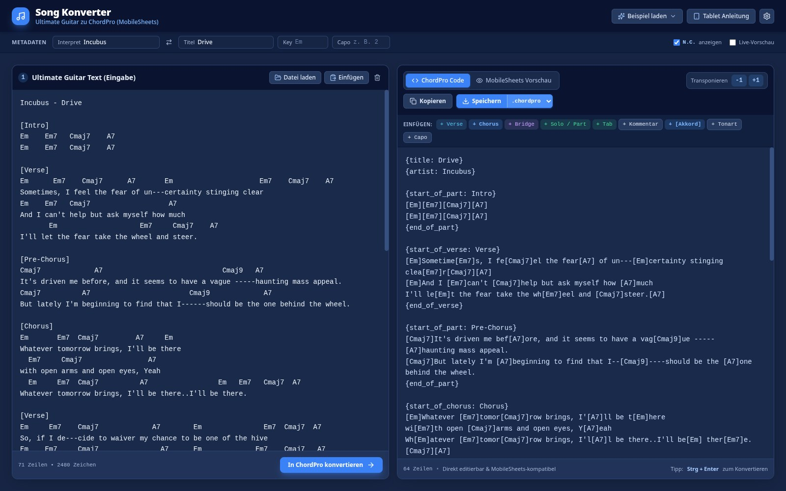

# Song Konverter
### Ultimate Guitar zu ChordPro (MobileSheets)

Eine moderne Webanwendung, die Songtexte mit Akkorden über den Textzeilen (wie sie typischerweise auf **Ultimate Guitar** zu finden sind) präzise in das standardisierte **ChordPro-Format** umwandelt. Das Ergebnis kann direkt heruntergeladen und auf einem **Android-Tablet in MobileSheets** importiert werden.



---

## Inhaltsverzeichnis

1. [Anleitung: Programm starten](#anleitung-programm-starten)
   - [Als Desktop-App (Linux, AppImage)](#als-desktop-app-linux-appimage)
2. [Hauptfunktionen im Überblick](#hauptfunktionen-im-überblick)
3. [Schritt-für-Schritt Bedienungsanleitung](#schritt-für-schritt-bedienungsanleitung)
4. [So funktioniert die Konvertierung](#so-funktioniert-die-konvertierung)
5. [Import in MobileSheets auf dem Android-Tablet](#import-in-mobilesheets-auf-dem-android-tablet)
6. [Tastenkürzel & Tipps](#tastenkürzel--tipps)
7. [Projektstruktur](#projektstruktur)

---

## Anleitung: Programm starten

### Voraussetzungen
- **Node.js** (Version 18 oder neuer)
- Ein aktueller Webbrowser (Google Chrome, Firefox, Safari oder Edge)

### Installation & Start in 3 Schritten:

1. **Abhängigkeiten installieren:**
   Öffne ein Terminal im Projektverzeichnis und führe folgenden Befehl aus:
   ```bash
   npm install
   ```

2. **Entwicklungsserver starten:**
   Starte den lokalen Server mit:
   ```bash
   npm run dev
   ```

3. **Im Browser öffnen:**
   Öffne deinen Webbrowser und navigiere zu:
   ```
   http://localhost:3000
   ```

*(Alternativ: Für einen optimierten Produktions-Build kann `npm run build` und anschließend `npm run preview` ausgeführt werden).*

---

## Als Desktop-App (Linux, AppImage)

Dieses Projekt ist mit Electron als eigenständige Desktop-Anwendung verpackt. Die fertige **AppImage** ist eine einzelne Datei, die ohne Installation auf nahezu jeder Linux-Distribution läuft (auch ohne Node.js).

### AppImage bauen
```bash
npm install
npm run dist:linux
```
Das Ergebnis liegt in `release/Song-Konverter-<Version>.AppImage` (ca. 120 MB).

### AppImage benutzen
```bash
chmod +x Song-Konverter-<Version>.AppImage
./Song-Konverter-<Version>.AppImage
```
Die Datei kann beliebig kopiert oder weitergegeben werden. Für einen Eintrag im Anwendungsmenü die Datei z. B. mit [Gear Lever](https://flathub.org/apps/it.mijorus.gearlever) oder AppImageLauncher integrieren.

### Updates
Fertige AppImages gibt es unter [Releases](https://github.com/govchecker/Song-Konverter-Desktop/releases). Jedes Release enthält die Datei `Song-Konverter-<Version>.AppImage`, und der Release-Tag lautet `v<Version>`.

Da das Repository privat ist, können AppImage-Manager wie Shelly keine Updates erkennen: Sie fragen die GitHub-Releases ohne Anmeldung ab und erhalten bei privaten Repositories nur „Not Found“. Neue Versionen daher von Hand aus den Releases herunterladen.

Hinweise:
- Benötigt auf manchen Systemen `fuse2` (Arch/CachyOS: `sudo pacman -S fuse2`). Alternativ: `./Song-Konverter-<Version>.AppImage --appimage-extract-and-run`.
- Auf Ubuntu 24.04 und neuer kann der Start mit einer Sandbox-Fehlermeldung scheitern. Dann mit `--no-sandbox` starten.

### Entwickeln mit Electron
In zwei Terminals:
```bash
npm run dev            # Vite-Entwicklungsserver auf Port 3000
npm run electron:dev   # Electron-Fenster, das den Entwicklungsserver lädt
```
Den gebauten Stand ohne Paketierung testen: `npm run electron:start`.

> Wird Electron aus VS Code oder einem anderen Electron-Programm heraus gestartet, kann die Umgebungsvariable `ELECTRON_RUN_AS_NODE` gesetzt sein. Dann startet Electron nicht als App. In dem Fall `env -u ELECTRON_RUN_AS_NODE npm run electron:start` verwenden.

---

## Hauptfunktionen im Überblick

- **Zwei editierbare Arbeitsfenster (Dual-Pane Layout):**
  - **Links:** Eingabe des originalen Ultimate-Guitar-Textes mit Akkorden über dem Text.
  - **Rechts:** Resultierendes ChordPro-Format. Dieses Fenster ist **direkt editierbar**, sodass du jederzeit manuelle Anpassungen vornehmen kannst.
- **Mehrere Möglichkeiten zur Texteingabe:**
  - Direktes Eintippen oder Bearbeiten im Textfeld.
  - **„Einfügen“-Button:** Fügt mit einem Klick den Inhalt der Zwischenablage ein.
  - **„Datei laden“-Button:** Liest Textdateien (`.txt`, `.crd`, `.tab`) vom Computer ein.
  - **Drag & Drop:** Textdateien können einfach per Ziehen und Ablegen in das linke Fenster fallen gelassen werden.
  - **Beispiel-Lieder:** Schnellauswahl mit dem Song **Incubus – Drive** sowie weiteren Vorlagen.
- **Konvertierungs-Button & Tastenkürzel:**
  - Prominenter Button **„In ChordPro konvertieren“**.
  - Schnelltaste: <kbd>Strg</kbd> + <kbd>Enter</kbd> (Mac: <kbd>Cmd</kbd> + <kbd>Enter</kbd>).
  - Optionaler Schalter **„Live-Vorschau“** für sofortiges Konvertieren während des Schreibens.
- **Zwei Ansichtsmodi im rechten Fenster:**
  - **ChordPro Code:** Quelltext-Editor mit Zeilennummern und Schnelleinfüge-Leiste für Tags (`+ Verse`, `+ Chorus`, `+ Bridge`, `+ Solo`, `+ [Akkord]`, etc.).
  - **MobileSheets Vorschau:** Naturgetreue Tablet-Darstellung des Notenblatts:
    - Akkorde werden in gut lesbarer hellblauer Schrift exakt über den jeweiligen Textsilben angezeigt.
    - Intro-, Solo- und Outro-Akkorde werden als normale Akkorde mit passendem Abstand dargestellt (ohne störende Rahmen oder Buttons).
    - Abschnitte (Verse, Chorus, Bridge, Solo, Outro) werden farblich gekennzeichnet.
    - Zoom-Funktion (<kbd>A-</kbd> / <kbd>A+</kbd>) zur Anpassung der Schriftgröße für Live-Auftritte.
- **Transponieren (+/- Halbtöne):**
  - Alle Akkorde im Dokument können per Klick um `-1` oder `+1` Halbtöne höher oder tiefer gesetzt werden.
- **Export & Speichern:**
  - Download als `.chordpro` (Standard für MobileSheets), `.cho`, `.pro` oder `.txt`.
  - Der Dateiname wird automatisch intelligent aus **Interpret – Titel** benannt (z. B. `Incubus - Drive.chordpro`).
  - Button **„Kopieren“** für schnelles Einfügen in andere Programme.

---

## Schritt-für-Schritt Bedienungsanleitung

### 1. Songtext einfügen (Linkes Fenster)
Kopiere deinen Songtext von Ultimate Guitar und füge ihn auf eine der folgenden Weisen ein:
- Klicke auf den Button **„Einfügen“** (liest die Zwischenablage aus) oder drücke <kbd>Strg</kbd> + <kbd>V</kbd>.
- Oder klicke auf **„Datei laden“**, um eine bestehende Textdatei auszuwählen.
- Oder ziehe eine `.txt`-Datei per Drag & Drop in das Textfeld.
- *Zum Ausprobieren:* Klicke oben rechts auf **„Beispiel laden“** und wähle **Incubus – Drive**.

### 2. Metadaten prüfen (Obere Leiste)
Das Programm erkennt automatisch aus der ersten Zeile:
- **Interpret** (z. B. *Incubus*)
- **Titel** (z. B. *Drive*)
- Sowie optional **Tonart (Key)** und **Capo** (z. B. *Capo: 2*).
- Falls die Quelle *„Titel - Interpret“* statt *„Interpret - Titel“* verwendet hat, klicke einfach auf das Pfeilsymbol (<kbd>⇄</kbd>), um beide Felder zu vertauschen.

### 3. In ChordPro umwandeln
Klicke unten im linken Fenster auf **„In ChordPro konvertieren“** (oder drücke <kbd>Strg</kbd> + <kbd>Enter</kbd>). Das rechte Fenster füllt sich augenblicklich mit dem fertigen ChordPro-Text.

### 4. Anpassen & Kontrollieren (Rechtes Fenster)
- **Modus „ChordPro Code“:** Hier kannst du beliebige Textstellen direkt mit der Tastatur anpassen oder die Schnell-Einfügeknöpfe für Abschnitte (`{start_of_chorus}`, `{end_of_chorus}`) nutzen.
- **Modus „MobileSheets Vorschau“:** Schalte oben auf diesen Tab um, um das Notenblatt genauso zu sehen, wie es später auf deinem Android-Tablet dargestellt wird.
- **Transponieren:** Mit den Buttons `-1` und `+1` kannst du die Tonart des gesamten Songs anpassen.

### 5. Datei speichern
Klicke oben rechts auf **„Speichern“**. Dein Browser lädt die Datei z. B. als `Incubus - Drive.chordpro` herunter.

---

## So funktioniert die Konvertierung

### Akkord-Ausrichtung über dem Text
Auf Ultimate Guitar stehen die Akkorde in einer eigenen Zeile über dem Text:
```text
Em      Em7    Cmaj7      A7       Em
Sometimes, I feel the fear of uncertainty
```

Der Konverter ermittelt die genaue Zeichenspalte (Spaltenindex) jedes Akkords und fügt ihn im ChordPro-Format `[Akkord]` zeichengenau in die Textzeile ein:
```text
[Em]Sometime[Em7]s, I fe[Cmaj7]el the fear[A7] of un---[Em]certainty
```

### Automatische Abschnittserkennung
Aus Abschnitten in eckigen Klammern generiert der Konverter die passenden MobileSheets-Direktiven:
- `[Verse]` / `[Verse 1]` ➔ `{start_of_verse: Verse}` ... `{end_of_verse}`
- `[Chorus]` / `[Refrain]` ➔ `{start_of_chorus: Chorus}` ... `{end_of_chorus}`
- `[Bridge]` ➔ `{start_of_bridge: Bridge}` ... `{end_of_bridge}`
- `[Intro]`, `[Pre-Chorus]`, `[Solo]`, `[Outro]` ➔ `{start_of_part: Intro}` ... `{end_of_part}`

### Reine Akkordzeilen (z. B. Intro & Solo)
Zeilen ohne Gesangstext (z. B. Akkordfolgen im Intro) werden kompakt und übersichtlich formatiert:
```text
[Em][Em7][Cmaj7][A7]
```
In der MobileSheets-Vorschau werden diese als normale Textakkorde nebeneinander dargestellt.

### Tabulaturen ({start_of_tab} & {end_of_tab} bzw. {sot} & {eot})
Das Programm erkennt Gitarren- und Bass-Tabulaturen vollautomatisch und bettet sie in ChordPro-Tabulatur-Direktiven ein:
- **`{start_of_tab}`** (Kurzform: **`{sot}`**): Markiert den Beginn einer Tabulatur.
- **`{end_of_tab}`** (Kurzform: **`{eot}`**): Markiert das Ende einer Tabulatur.

Beispiel einer umgewandelten Tabulatur:
```text
{start_of_tab}
G |----------------------------|-----7--5--7L-7-------------|
D |-----7--5--7L-7-------------|-----------------7--5-------|
A |-----------------7--5-------|--5--------------------8----|
E |--5--------------------8----|----------------------------|
{end_of_tab}
```
**Vorteil in MobileSheets & Vorschau:** Der gesamte Inhalt zwischen `{start_of_tab}` und `{end_of_tab}` wird in einer echten **Monospace-Schriftart** (feste Zeichenbreite) ohne Umbrüche mit horizontalem Scrollen dargestellt. Dadurch behält jedes Zeichen exakt dieselbe Breite und alle Bünde, Saiten und Taktstriche bleiben perfekt untereinander ausgerichtet. In der Schnell-Einfügeleiste des Editors steht dafür zudem der Button **`+ Tab`** zur Verfügung.

Auch vorangestellte Abschnitts-Überschriften wie **`[Tab]`**, **`[Tabulatur]`**, **`[Tabs]`**, **`[Guitar Tab]`** oder **`[Bass Tab]`** werden automatisch erkannt und direkt in den Tabulatur-Block `{start_of_tab}` ... `{end_of_tab}` überführt.

### Unterstützte Akkorde (Kein Limit!)
Das Programm setzt **kein Limit** auf die Akkordvielfalt. Die Erkennung basiert auf einer universellen musiktheoretischen Formel und unterstützt alle gängigen und komplexen Akkordvarianten:
- **Grundakkorde & Moll:** `C`, `Dm`, `Em`, `F`, `G`, `Am`, `H`, `Hm` (inkl. deutscher H/B-Notation)
- **Vorzeichen:** `#` und `b` (`C#`, `Db`, `F#m`, `Bb`, `Ebmaj7` etc.)
- **Septakkorde & Erweiterungen:** `7`, `maj7`, `min7`, `dom7`, `9`, `maj9`, `11`, `13`, `Δ7`
- **Suspended & Added:** `sus2`, `sus4`, `7sus4`, `add9`, `add2`, `add4`, `add11`
- **Power Chords:** `C5`, `E5`, `A5`, `F#5`
- **Vermindert & Übermäßig:** `dim`, `dim7`, `aug`, `+`, `-`, `o`, `º`, `°`, `ø`, `ø7`
- **Alterierte Akkorde:** `7b5`, `7#5`, `7b9`, `7#9`, `7#11`, `7b13`, `m7b5` (auch in Klammern wie `C7(#9)`)
- **Sextakkorde:** `6`, `m6`, `6/9`, `6add9`
- **Slash-Akkorde (Bassnoten):** `D/F#`, `G/B`, `C/E`, `Am/G`, `F#m7/E`, `Bb/D`
- **Spezielle Bezeichnungen:** `N.C.` (No Chord / Pause) – standardmäßig im ChordPro-Dokument eingebunden und optional per Checkbox ausblendbar.

---

## Import in MobileSheets auf dem Android-Tablet

1. **Datei auf das Tablet übertragen:**
   Übertrage die heruntergeladene `.chordpro`-Datei per **Google Drive**, **USB-Kabel**, **Nextcloud**, **Dropbox** oder per **E-Mail** auf dein Android-Tablet.
2. **MobileSheets öffnen:**
   Starte die App *MobileSheets* (oder *MobileSheetsPro*).
3. **Song importieren:**
   - Tippe in der Menüleiste auf **Importieren** ➔ **Datei**.
   - Wähle deine `.chordpro`-Datei im Dateimanager aus.
4. **Fertig:**
   MobileSheets liest den Song vollautomatisch ein. Du hast sofort Zugriff auf:
   - Automatische Akkorddarstellung
   - Transponieren per Fingertipp
   - Automatisches Scrollen (Auto-Scroll) während des Spielens
   - Hinzufügen zu Setlisten

---

## Tastenkürzel & Tipps

| Tastenkürzel | Funktion |
| :--- | :--- |
| <kbd>Strg</kbd> + <kbd>Enter</kbd> | Konvertiert den Text im linken Fenster sofort in das rechte Fenster |
| <kbd>Strg</kbd> + <kbd>V</kbd> | Text in das aktive Feld einfügen |
| <kbd>Strg</kbd> + <kbd>A</kbd> | Gesamten Text im Feld markieren |

**Tipp:** Wenn du Texte kontinuierlich bearbeitest, aktiviere die Checkbox **„Live-Vorschau“** in der oberen Leiste. Dann wird jede Tastatureingabe im linken Fenster sofort in Echtzeit im rechten Fenster aktualisiert.

---

## Projektstruktur

```
├── README.md                           # Diese ausführliche Benutzeranleitung
├── package.json                        # Projektkonfiguration, Abhängigkeiten und electron-builder-Einstellungen
├── index.html                          # HTML-Einstiegsseite
├── vite.config.ts                      # Vite-Konfiguration (React, Tailwind CSS)
├── screenshot.jpg                      # Screenshot für diese Anleitung
├── electron/
│   └── main.cjs                        # Electron-Hauptprozess (Fenster, lädt Vite-Server bzw. dist/)
├── build/
│   ├── icon.svg                        # App-Icon (Vorlage)
│   └── icon.png                        # App-Icon für die AppImage
├── src/
│   ├── main.tsx                        # React Root Einstiegspunkt
│   ├── App.tsx                         # Hauptkomponente mit Dual-Pane Benutzeroberfläche
│   ├── index.css                       # Styling mit Tailwind CSS
│   ├── components/
│   │   ├── ChordProToolbar.tsx         # Werkzeugleiste (Vorschau-Umschalter, Transponieren, Download)
│   │   ├── MobileSheetsPreview.tsx     # Naturgetreue Tablet-Vorschau für MobileSheets
│   │   ├── MobileSheetsGuideModal.tsx  # Schritt-für-Schritt Tablet-Importanleitung (Dialog)
│   │   └── ConversionSettingsModal.tsx # Einstellungen für Formatierung und Direktiven
│   └── utils/
│       ├── chordproConverter.ts        # Kernalgorithmus: Zeichengenaue Akkordeinbindung & Direktiven
│       ├── chordTransposer.ts          # Transponier-Logik für Akkorde (+/- Halbtöne)
│       └── sampleSongs.ts              # Beispiel-Songs (inkl. Incubus – Drive)
```
